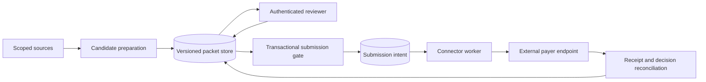

# System design through a failure

Start with a business invariant: **the packet submitted must be the packet an
authorized reviewer approved**. Then ask what happens when another worker edits it.

## Design sketch



This is a proposed design, not the architecture of a verified Kodiflex deployment.
The original prior-auth lab simulates parts of it. The separate review-race example
below implements a narrow SQLite transition; it does not implement the entire diagram.

## Worked architecture decision

**Problem:** a worker reads “approved,” another edits the packet, and the first sends.

**Decision:** store a monotonically changing packet version and bind approval to
that version. In one local database transaction, re-read the approved version,
validate the current version and record submission intent. Reject stale review.

**Alternative rejected:** clear an approval flag only when the UI changes a field.
That misses imports, background workers and other clients.

**Consequence:** the database orders local edits and intents. A real external send
still needs an outbox worker, a remote idempotency contract and reconciliation.
The database cannot make an external service part of its local transaction.

**Change after intent:** this demo freezes the packet once intent is recorded.
A production workflow needs an explicit cancel/amend process; overwriting the
packet would lose the meaning of the recorded intent.

## Run and inspect

```sh
python system-design/review_race.py
python -m unittest discover -s system-design -p 'test_*.py' -v
```

The demo uses separate SQLite connections to represent two workers. A stale reader
sees the old approved version; another worker edits. The submission gate checks
current durable state and rejects. Tests also cover repeat submission and edits
after recorded intent. This is an interleaving demonstration, not a load test.

## Design exercises

1. Draw a C4 context diagram showing people and external systems.
2. Draw the components that hold durable state and enforce authorization.
3. Write a sequence for “accepted remotely, response lost.”
4. Decide which failures retry, which reconcile and which escalate.
5. Define a useful service-level indicator, such as time to assign unresolved cases,
   with a denominator and clear exclusions. Do not equate model response speed with
   completion of the entire business process.
6. Explain how you would test two concurrent approvals and policy changes.

## Read, then apply

- [C4 model](https://c4model.com/): draw context and container views; label trust boundaries separately.
- [AWS safe retries](https://aws.amazon.com/builders-library/making-retries-safe-with-idempotent-APIs/): specify same-key/same-intent and same-key/different-intent behavior.
- [Microsoft cloud design patterns](https://learn.microsoft.com/en-us/azure/architecture/patterns/): compare retry, circuit breaker and asynchronous request-reply patterns; use only patterns your failure modes justify.
- [Google SRE books](https://sre.google/books/): use the freely readable Workbook and original SRE book for objectives, monitoring and incident practice. The catalog also includes paid editions.

An architecture diagram is assessed by the failure it explains and the decision
it supports. Adding more services or agents is not evidence of better design.
